<div align="center">


# Meta Pix

**Your Images. Perfectly Optimized.**

সোশ্যাল মিডিয়ার জন্য ছবি তৈরি করার একটি সহজ অ্যাপ — SEO মেটাডাটা যোগ করুন, যেকোনো প্ল্যাটফর্মের মাপে রিসাইজ করুন, JPEG / PNG / WebP ফরম্যাটে এক্সপোর্ট করুন।

[](https://github.com/Mostafijemon24/Meta-Pix/releases/latest)

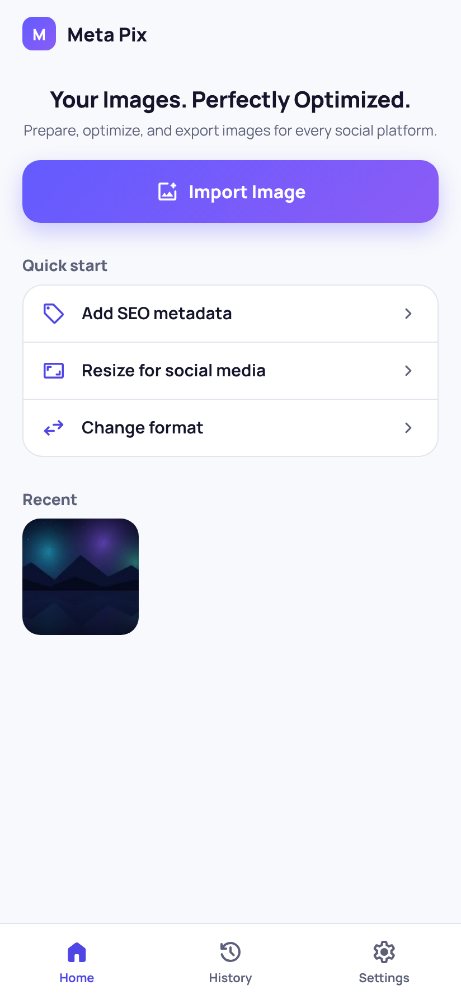
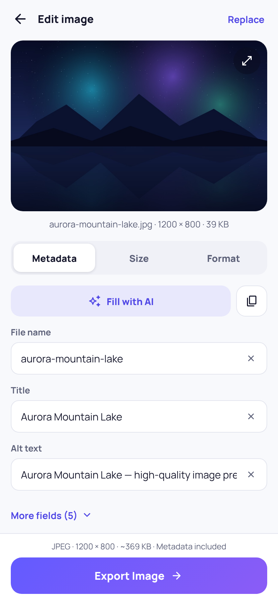
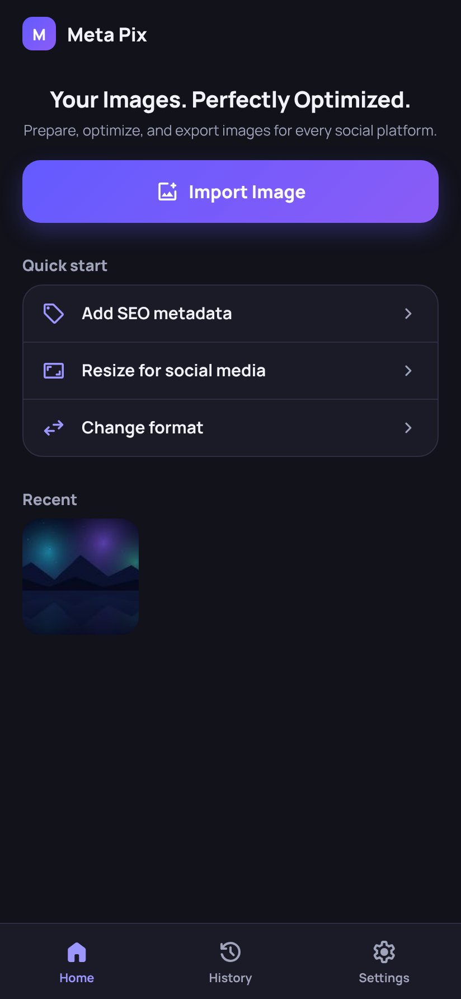

</div>

---

## সূচিপত্র

1. [Meta Pix কী?](#meta-pix-কী)
2. [মূল বৈশিষ্ট্য](#মূল-বৈশিষ্ট্য)
3. [ইনস্টল করার নিয়ম (Android APK)](#ইনস্টল-করার-নিয়ম-android-apk)
4. [ব্যবহার বিধি — ধাপে ধাপে](#ব্যবহার-বিধি--ধাপে-ধাপে)
5. [সোশ্যাল মিডিয়া সাইজ তালিকা](#সোশ্যাল-মিডিয়া-সাইজ-তালিকা)
6. [Settings](#settings)
7. [সাধারণ প্রশ্ন ও সমস্যার সমাধান](#সাধারণ-প্রশ্ন-ও-সমস্যার-সমাধান)
8. [ডেভেলপারদের জন্য](#ডেভেলপারদের-জন্য)

---

## Meta Pix কী?

Meta Pix হলো AI দিয়ে তৈরি বা যেকোনো ছবিকে **SEO-বান্ধব ও সোশ্যাল-মিডিয়া-রেডি** করার একটি স্টুডিও।

এখানে কোনো বাধ্যতামূলক ধাপ নেই। আপনি চাইলে —

- শুধু মেটাডাটা যোগ করে এক্সপোর্ট করতে পারেন,
- শুধু রিসাইজ করে এক্সপোর্ট করতে পারেন,
- শুধু ফরম্যাট বদলে এক্সপোর্ট করতে পারেন,
- অথবা সব মেটাডাটা মুছে একদম পরিষ্কার ছবি এক্সপোর্ট করতে পারেন।

> ✅ **আপনার মূল ছবি কখনো পরিবর্তন হয় না।** প্রতিটি এক্সপোর্ট একটি নতুন ফাইল।

## মূল বৈশিষ্ট্য

| | বৈশিষ্ট্য | বিবরণ |
|---|---|---|
| 🖼️ | **লাইভ প্রিভিউ** | ছবি ইমপোর্ট করার সাথে সাথেই স্ক্রিনের উপরে বড় করে দেখায় — নাম, মাপ ও ফাইল সাইজসহ |
| 🏷️ | **SEO মেটাডাটা** | File name, Title, Alt text, Description, Focus keyword, Related keywords, Caption, Tags — সবই ঐচ্ছিক |
| ©️ | **কপিরাইট** | Creator, Copyright owner, Copyright notice — ডিফল্ট নাম `Mostafij Emon`, ইচ্ছেমতো বদলানো বা বন্ধ করা যায় |
| 🧹 | **মেটাডাটা নিয়ন্ত্রণ** | Keep / Update / Remove all — চাইলে EXIF, IPTC, XMP সব মুছে দিন |
| 📐 | **সোশ্যাল সাইজ প্রিসেট** | Facebook, Instagram, LinkedIn, X, Pinterest — Horizontal / Square / Vertical |
| ✏️ | **কাস্টম সাইজ** | যেকোনো Width × Height, Aspect ratio লক, নিজের প্রিসেট সেভ ও ডিলিট |
| ✂️ | **Crop বা Fit** | ছবি কখনো টেনে লম্বা/চ্যাপ্টা হয় না — হয় কেটে ফিট, নয়তো বর্ডার যোগ |
| 💾 | **JPEG / PNG / WebP** | Quality স্লাইডার, কাস্টম ফাইল নাম |
| 📤 | **যেকোনো সময় এক্সপোর্ট** | Export বাটন সবসময় নিচে স্থির থাকে |
| 🕘 | **History** | আগের এক্সপোর্টগুলো দেখুন, শেয়ার করুন বা মুছুন |
| 🌙 | **Light / Dark মোড** | অথবা ফোনের সেটিং অনুযায়ী (System) |

---

## ইনস্টল করার নিয়ম (Android APK)

1. ফোন থেকে **[Releases পেজে](https://github.com/Mostafijemon24/Meta-Pix/releases/latest)** যান।
2. **Assets** অংশে `MetaPix-vX.X.X.apk` ফাইলে চাপ দিয়ে ডাউনলোড করুন।
3. ডাউনলোড শেষ হলে ফাইলটি খুলুন।
4. প্রথমবার **"Install unknown apps"** অনুমতি চাইলে — *Settings* এ গিয়ে আপনার ব্রাউজার (যেমন Chrome) এর জন্য **Allow from this source** চালু করুন।
5. **Install** চাপুন। হোম স্ক্রিনে **Meta Pix** আইকন চলে আসবে।

> 📱 দরকার: Android 6.0 বা নতুন সংস্করণ। ইন্টারনেট ছাড়াই অ্যাপ চলে।

**ব্রাউজারে / ওয়েবসাইটে ব্যবহার করতে চাইলে:** Vercel-এ হোস্ট করা **Meta Pix** ওয়েবসাইট খুলুন (`web/` — বিস্তারিত নিচে)। অথবা লোকাল Vite অ্যাপ (`app/`) Chrome এ চালিয়ে **Install app / Add to Home screen** চাপুন।

---

## ওয়েবসাইট (Vercel + OpenRouter)

`web/` ফোল্ডারে SEO-বান্ধব **Next.js** সাইট আছে — একই নামে **Meta Pix**।

| | |
|---|---|
| ল্যান্ডিং | `/` — sitemap, robots, Open Graph, JSON-LD |
| স্টুডিও | `/studio` — মেটাডাটা, রিসাইজ, এক্সপোর্ট |
| AI | `/api/ai/optimize` — OpenRouter **ফ্রি** vision মডেল ছবি দেখে SEO ফিল্ড + সাইজ/ফরম্যাট অটো পূরণ করে |

```bash
cd web
cp .env.example .env.local   # OPENROUTER_API_KEY দিন
npm install
npm run dev                  # http://localhost:3000
```

**Vercel এ ডিপ্লয় (প্রজেক্ট নাম: `meta-pix`):**

1. [vercel.com](https://vercel.com) এ GitHub রিপো ইমপোর্ট করুন
2. **Root Directory** = `web`
3. Project name = `meta-pix` → live: [meta-pix-mauve.vercel.app](https://meta-pix-mauve.vercel.app)  
   (`meta-pix.vercel.app` already taken globally on Vercel.)
4. Environment variables:
   - `OPENROUTER_API_KEY` — [openrouter.ai/keys](https://openrouter.ai/keys)
   - `NEXT_PUBLIC_SITE_URL=https://meta-pix-mauve.vercel.app`
   - (ঐচ্ছিক) `OPENROUTER_MODEL=openrouter/free`

বিস্তারিত: [`web/README.md`](web/README.md)

---

## ব্যবহার বিধি — ধাপে ধাপে

### ধাপ ১ — ছবি ইমপোর্ট করুন

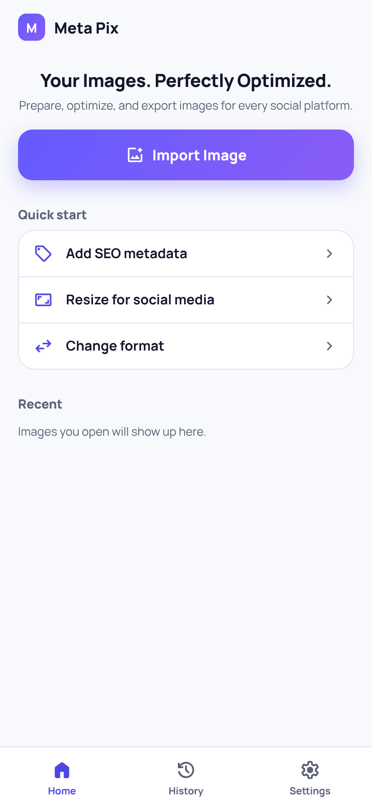

হোম স্ক্রিনে **Import Image** চাপুন, তারপর **Browse files** থেকে ছবি বেছে নিন।

**Quick start** থেকে সরাসরি কাজ শুরু করা যায়:

- **Add SEO metadata** — ছবি খুলেই Metadata ট্যাবে নিয়ে যাবে
- **Resize for social media** — Instagram সাইজ বাছাই করা অবস্থায় Size ট্যাব খুলবে
- **Change format** — WebP বাছাই করা অবস্থায় Format ট্যাব খুলবে

আগে খোলা ছবিগুলো **Recent** এ দেখা যায় — এক চাপে আবার খুলুন।

<br clear="right" />

### ধাপ ২ — এডিটর চিনে নিন


এডিটরের তিনটি অংশ:

1. **উপরে প্রিভিউ** — ছবির নাম, মাপ (px) ও সাইজ। ↗ বাটনে ফুল-স্ক্রিন দেখুন। ছবি বদলাতে উপরের **Replace** চাপুন।
2. **মাঝে তিনটি ট্যাব** — **Metadata**, **Size**, **Format**। যেকোনো ট্যাবে যান — আগের লেখা হারাবে না।
3. **নিচে Export বার** — বর্তমান ফরম্যাট, মাপ, আনুমানিক সাইজ ও মেটাডাটার অবস্থা দেখায়। **Export Image** যেকোনো সময় চাপুন।

> 💡 কোনো ঘর পূরণ করা বাধ্যতামূলক নয়। ছবি খুলেই সরাসরি Export করতে পারেন।

<br clear="right" />

### ধাপ ৩ — Metadata (ঐচ্ছিক)

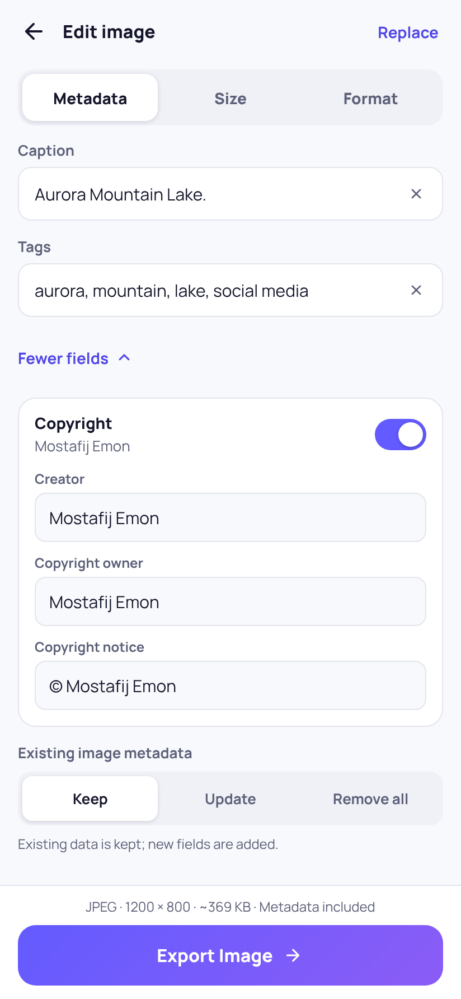

- **Fill with AI** — ফাইলের নাম থেকে Title, Alt text, Keywords ইত্যাদি স্বয়ংক্রিয়ভাবে পূরণ করে। তারপর ইচ্ছেমতো এডিট করুন।
- প্রতিটি ঘরের পাশের **✕** চাপলে সেই ঘর খালি হয়।
- **⧉ (Copy)** বাটন সব মেটাডাটা একসাথে কপি করে — ওয়েবসাইট বা পোস্টে পেস্ট করার জন্য।
- **More fields (5)** চাপলে Description, Focus keyword, Related keywords, Caption, Tags দেখা যাবে।

**Copyright:** সুইচ চালু থাকলে Creator, Copyright owner ও Copyright notice ছবির ভেতরে যুক্ত হয়। নামের উপর চাপ দিয়ে এডিট করুন, অথবা সুইচ বন্ধ করে কপিরাইট বাদ দিন।

**Existing image metadata** (ছবিতে আগে থেকে থাকা ক্যামেরা/EXIF তথ্য):

| অপশন | কী হয় |
|---|---|
| **Keep** | পুরনো তথ্য থাকে, নতুন ঘরগুলো যোগ হয় |
| **Update** | আপনি যেগুলো লিখেছেন সেগুলো বদলায় |
| **Remove all** | EXIF / IPTC / XMP সব মুছে একদম পরিষ্কার ছবি |

<br clear="right" />

### ধাপ ৪ — Size (ঐচ্ছিক)

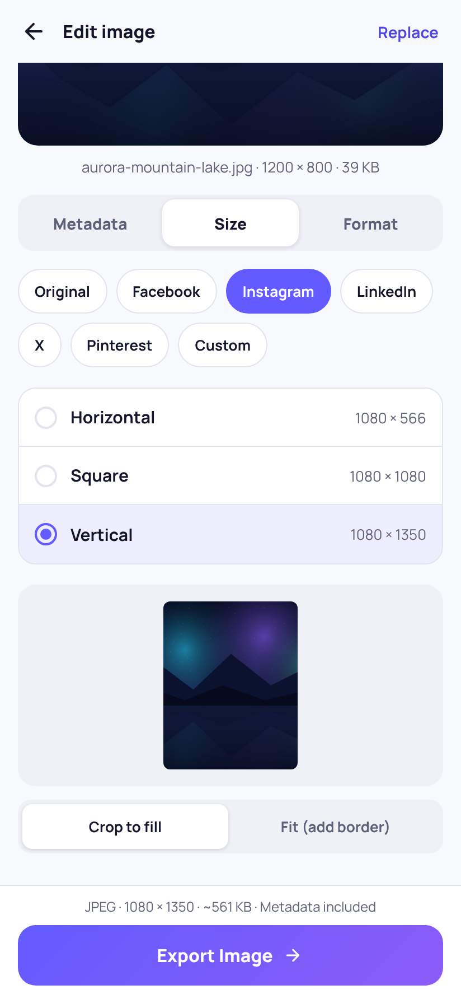

1. প্ল্যাটফর্ম বাছুন: **Original**, Facebook, Instagram, LinkedIn, X, Pinterest অথবা **Custom**।
2. **Horizontal / Square / Vertical** থেকে একটি বাছুন (Pinterest এ **Long vertical** ও আছে)।
3. নিচের প্রিভিউতে ফলাফল দেখুন, তারপর বাছুন:
   - **Crop to fill** — পুরো ফ্রেম ভরাট, কিনারা একটু কাটা পড়ে
   - **Fit (add border)** — পুরো ছবি দেখা যায়, ফাঁকা জায়গায় বর্ডার (JPEG এ সাদা, PNG/WebP এ স্বচ্ছ)

**Original** রাখলে ছবির মাপ বদলায় না।

<br clear="right" />

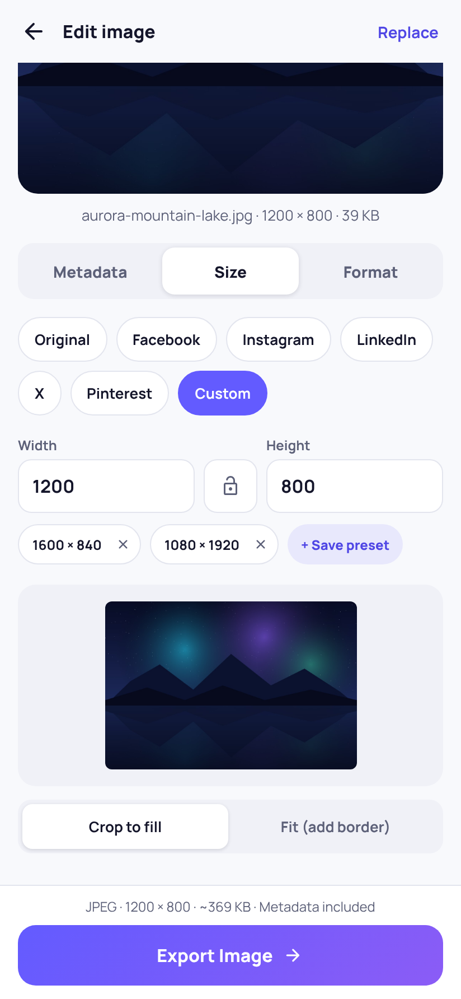

**Custom সাইজ:**

- **Width** ও **Height** লিখুন (pixel এ)।
- মাঝের 🔒 বাটনে Aspect ratio লক করুন — একটি বদলালে অন্যটি নিজে থেকে মিলে যাবে।
- **+ Save preset** চাপলে মাপটি পরের বারের জন্য সেভ হয়। সেভ করা প্রিসেটে চাপ দিলে প্রয়োগ হয়, **✕** চাপলে মুছে যায়।

<br clear="right" />

### ধাপ ৫ — Format ও সেভ করার জায়গা (ঐচ্ছিক)

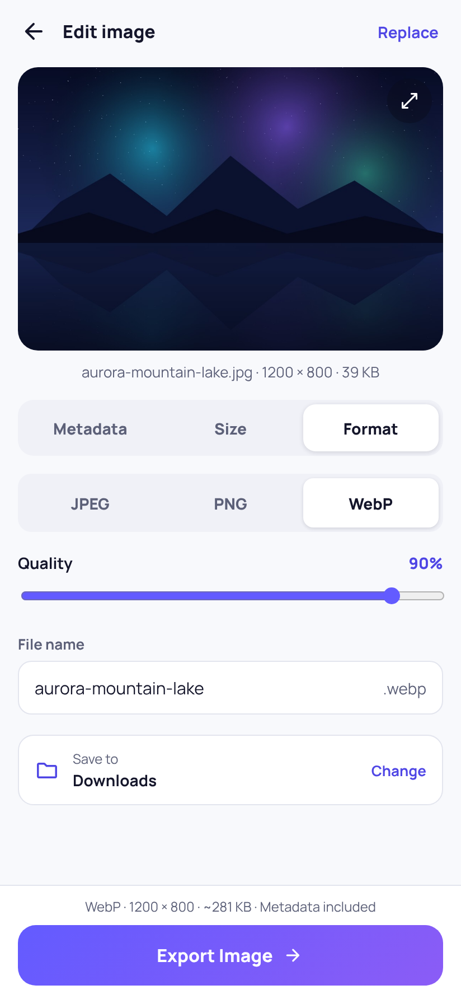

- **JPEG** — ছবির জন্য সবচেয়ে প্রচলিত, ছোট সাইজ।
- **PNG** — Lossless, স্বচ্ছতা (transparency) রাখে, সাইজ বড়।
- **WebP** — আধুনিক ফরম্যাট, ওয়েবসাইটের জন্য সেরা, ছোট সাইজে ভালো মান।
- **Quality** স্লাইডার (JPEG/WebP) — বেশি মানে ভালো মান কিন্তু বড় ফাইল। সাধারণত **80–90%** যথেষ্ট।
- **File name** — এক্সপোর্ট হওয়া ফাইলের নাম। খালি রাখলে মূল ফাইলের নাম ব্যবহার হয়।
- **Save to** — কোথায় সেভ হবে। **Change** চেপে বদলান।

<br clear="right" />

### ধাপ ৬ — Export

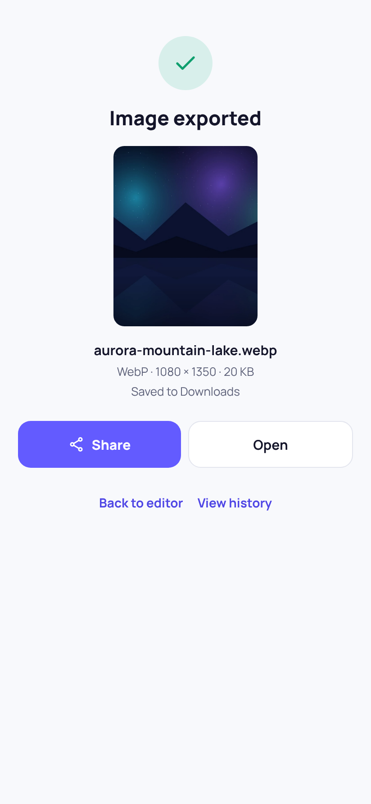

নিচের **Export Image →** চাপুন। কয়েক সেকেন্ডে ছবি তৈরি হবে এবং দেখাবে:

- ফাইলের নাম, ফরম্যাট, মাপ ও আসল সাইজ
- কোথায় সেভ হয়েছে

এরপর:

- **Share** — WhatsApp, Facebook, Drive ইত্যাদিতে সরাসরি পাঠান
- **Open** — ছবিটি বড় করে দেখুন
- **Back to editor** — আরেকটি সাইজ/ফরম্যাটে আবার এক্সপোর্ট করুন
- **View history** — আগের সব এক্সপোর্ট

> 📁 **APK অ্যাপে ছবি কোথায় যায়?** ফোনের **Documents › MetaPix** ফোল্ডারে। (ব্রাউজারে ব্যবহার করলে **Downloads** ফোল্ডারে।)

<br clear="right" />

### ধাপ ৭ — History

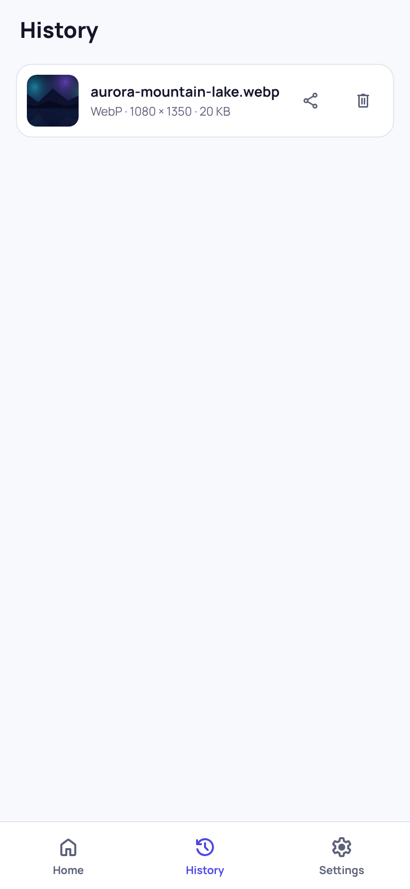

নিচের মেনু থেকে **History** খুলুন। প্রতিটি এক্সপোর্টের নাম, ফরম্যাট, মাপ ও সাইজ দেখা যায়।

- **Share** আইকন — ফাইলটি আবার শেয়ার করুন
- **Delete** আইকন — তালিকা থেকে মুছুন (ফোনের ফাইল মোছে না)

<br clear="right" />

---

## সোশ্যাল মিডিয়া সাইজ তালিকা

| প্ল্যাটফর্ম | Horizontal | Square | Vertical |
|---|---|---|---|
| **Facebook** | 1200 × 630 | 1080 × 1080 | 1080 × 1350 |
| **Instagram** | 1080 × 566 | 1080 × 1080 | 1080 × 1350 |
| **LinkedIn** | 1200 × 627 | 1080 × 1080 | 1080 × 1350 |
| **X (Twitter)** | 1600 × 900 | 1080 × 1080 | 1080 × 1350 |
| **Pinterest** | 1500 × 1000 | 1000 × 1000 | 1000 × 1500 · Long: 1000 × 2100 |

এগুলো প্রস্তাবিত মাপ, বাধ্যতামূলক নয়। অন্য কোনো মাপ লাগলে **Custom** ব্যবহার করুন।

---

## Settings

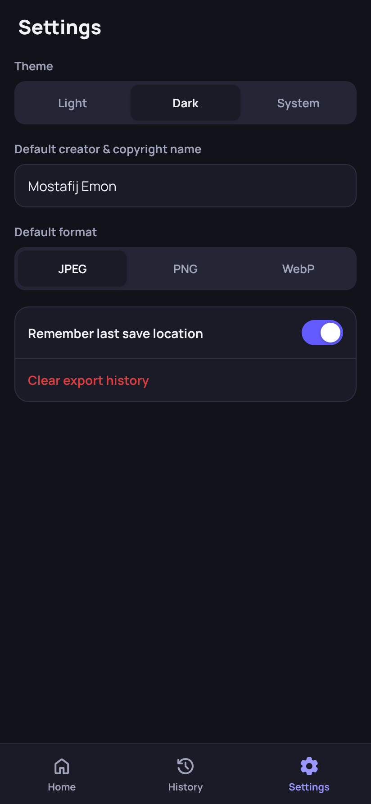

- **Theme** — Light, Dark অথবা System (ফোনের সেটিং অনুযায়ী)।
- **Default creator & copyright name** — নতুন ছবিতে কপিরাইটে কোন নাম বসবে। ডিফল্ট: `Mostafij Emon`। আপনার বা আপনার কোম্পানির নাম দিন।
- **Default format** — নতুন ছবির জন্য শুরুর ফরম্যাট।
- **Remember last save location** — শেষ ব্যবহৃত ফোল্ডার মনে রাখে।
- **Clear export history** — History তালিকা পুরো খালি করে।

সব সেটিং ফোনেই সংরক্ষিত থাকে — কোনো অ্যাকাউন্ট বা ইন্টারনেট লাগে না।

<br clear="right" />

---

## সাধারণ প্রশ্ন ও সমস্যার সমাধান

**ছবি কি কোথাও আপলোড হয়?**
Android অ্যাপ / লোকাল Vite বিল্ডে সব কাজ ডিভাইসেই হয়। **ওয়েবসাইটের Auto Optimize** চালু থাকলে SEO জেনারেটের জন্য ছবির একটি ছোট প্রিভিউ OpenRouter API তে যায় (আপনার API কী দিয়ে); এক্সপোর্ট ফাইল সার্ভারে সেভ হয় না।

**Export এর আগে দেখানো সাইজ আর আসল সাইজ আলাদা কেন?**
Export বারের সাইজ একটি আনুমানিক হিসাব। আসল সাইজ এক্সপোর্টের পর দেখায়।

**মেটাডাটা আছে কিনা কীভাবে বুঝব?**
Export বারে লেখা থাকে: *Metadata included*, *Metadata removed* অথবা *No metadata*। এক্সপোর্ট করা ফাইল কম্পিউটারে Properties / Get Info বা যেকোনো EXIF viewer দিয়ে দেখতে পারেন।

**"App not installed" দেখাচ্ছে।**
পুরনো কোনো ভার্সন অন্য সাইনিং কী দিয়ে ইনস্টল থাকলে এটি হয়। পুরনো Meta Pix আনইনস্টল করে আবার ইনস্টল করুন।

**Gallery তে এক্সপোর্ট করা ছবি দেখছি না।**
**Files** অ্যাপ খুলে **Documents › MetaPix** ফোল্ডারে দেখুন। অথবা Export এর পর **Share** চেপে Gallery / Photos এ সেভ করুন।

**"Fill with AI" / Auto Optimize কি সত্যিকারের AI?**
ওয়েবসাইট (`web/`) এ হ্যাঁ — OpenRouter ফ্রি vision মডেল ছবি দেখে মেটাডাটা, প্ল্যাটফর্ম সাইজ ও ফরম্যাট সাজেস্ট করে। Android/Vite অ্যাপে এখনো ফাইলের নাম থেকে সাজেশন হয়; বর্ণনামূলক নাম (যেমন `sunset-beach-cox-bazar.jpg`) ভালো ফল দেয়।

---

## ডেভেলপারদের জন্য

- **ওয়েবসাইট:** Next.js → [`web/`](web/) (Vercel)
- **মোবাইল/PWA:** React + Vite + Capacitor → [`app/`](app/)

```bash
# Website
cd web && npm install && npm run dev

# Mobile / PWA
cd app
npm install
npm run dev        # http://localhost:5173
npm test
npm run build
```

**নতুন APK রিলিজ:** একটি ভার্সন ট্যাগ পুশ করুন —

```bash
git tag v1.0.1
git push origin v1.0.1
```

GitHub Actions ([`.github/workflows/release-apk.yml`](.github/workflows/release-apk.yml)) নিজে থেকে APK বানিয়ে **Releases** এ যুক্ত করবে।

APK সাইন করার জন্য রিপোজিটরির **Settings › Secrets and variables › Actions** এ এই চারটি secret লাগবে: `KEYSTORE_BASE64`, `KEYSTORE_PASSWORD`, `KEY_ALIAS`, `KEY_PASSWORD`। না থাকলে APK একটি অস্থায়ী debug key দিয়ে সাইন হয়।

কোডের গঠন ও সীমাবদ্ধতা: [`app/README.md`](app/README.md)

---

<div align="center">

© Mostafij Emon

</div>
